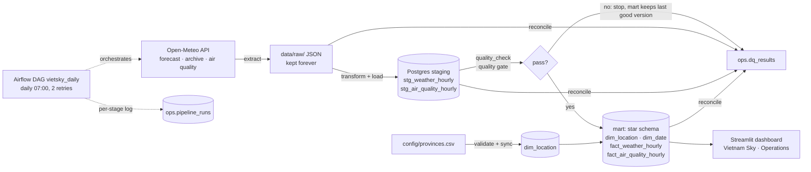
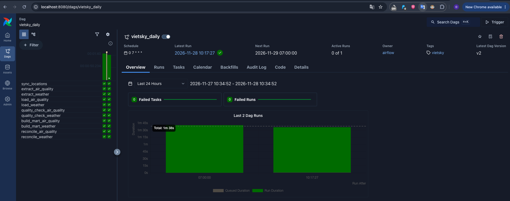
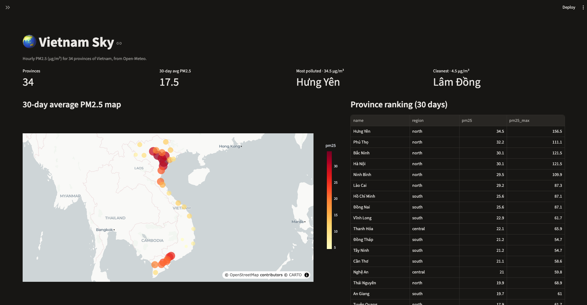
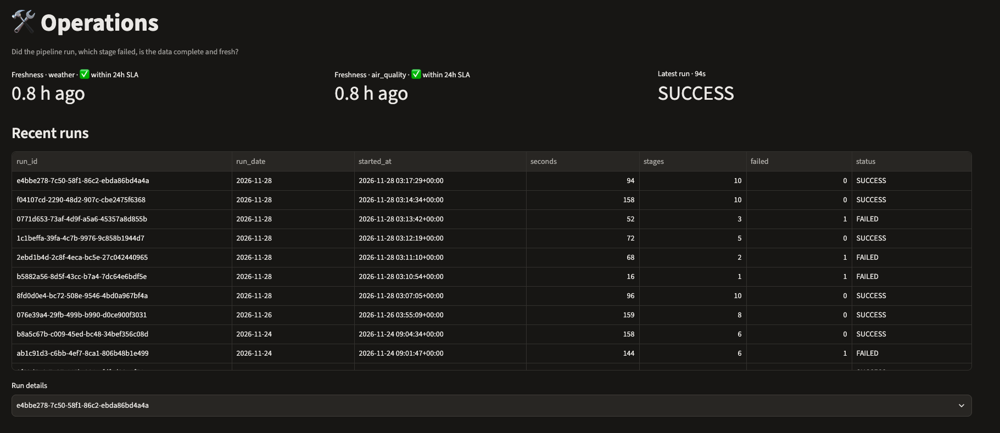

# VietSky

An hourly weather and air-quality data pipeline for Vietnam's 34 provinces (post-merger boundaries, effective 2025-07-01), covering August 2022 to today: **~2.58 million records**.
Data flows raw → staging → quality gate → star schema. Airflow orchestrates the pipeline, 9 automated data quality checks guard it (including a daily raw = staging = mart reconciliation), and a two-page dashboard serves analytics and operations. Six incident scenarios were drilled, with postmortems and a runbook.

**Stack:** Python 3.13 · PostgreSQL 16 · Apache Airflow 3 · Docker Compose · pandas · DuckDB · Parquet · Streamlit · Plotly · pytest

## Architecture



**Data flow:**
1. **Source:** hourly data for 34 provinces from Open-Meteo, in two sources: weather and air quality. Every API call retries with exponential backoff on transient errors.
2. **Raw:** each response is stored as-is in `data/raw/` before any processing. Raw is the source of truth: if the database breaks, it can be rebuilt from raw without calling the API again.
3. **Transform + load:** one row per hour. Local times get their timezone attached and are stored in UTC, and API field names are mapped to database column names. Rows are upserted into staging on the natural key (province, hour), so re-runs never create duplicates and values the source revises get updated.
4. **Mart:** once the quality gate passes, the `build_mart` stage builds a star schema in the `mart` schema. Fact grain is 1 province × 1 hour. Hour, day, month and season are precomputed in Vietnam time. Dimensions are upserted to keep keys stable, facts are fully rebuilt. Staging and mart row counts must match, otherwise the transaction rolls back and the previous mart is kept.
5. **Quality:** the `quality_check` stage (`src/vietsky/quality.py`) runs **before** the mart as a gate (Write-Audit-Publish). It checks the freshly loaded window (8 days) and writes every result to `ops.dq_results`. A `CRITICAL` failure stops the mart build, while a `WARNING` is only recorded. The `reconcile` stage runs after the mart. Details are in [Data quality and incident drills](#data-quality-and-incident-drills).
6. **Orchestration:** the Airflow DAG `vietsky_daily` runs at 07:00 Vietnam time. Both sources run in parallel and every task retries twice, except the check stages. Retries are safe because every stage is idempotent: upserts, full mart refresh, and stage logs that overwrite by `run_id`.
7. **Serving:** a two-page Streamlit dashboard.
   - **Analytics:** PM2.5 map, trends, hour × month heatmap, rain and wind correlation.
   - **Operations:** freshness, recent runs, rows per stage, quality pass rate.
8. **Operations:** every run has a `run_id`. Each stage writes one row to `ops.pipeline_runs` with status, timing, `rows_in`/`rows_out` and the error, so you can tell whether the pipeline ran and which stage broke.

## Screenshots

**Airflow: DAG `vietsky_daily` succeeding**



**Dashboard: Vietnam Sky (analytics)**



**Dashboard: Operations**



## Project structure

```
config/provinces.csv     34 provinces with coordinates (built by src/vietsky/geocode.py, 6 fixed manually)
dags/vietsky_daily.py    Airflow DAG
dashboard/app.py         Streamlit dashboard (analytics + operations)
pipelines/               run_pipeline.py (daily), backfill.py (history), export_lake.py + benchmark.py (Parquet)
sql/                     00_ops (logging tables), 01_staging, 02_mart, mart/ (build SQL), explore + dq_checks (ad-hoc)
src/vietsky/             config, extract, transform, load, stages, quality, mart, run_log, validate, chaos
tests/                   pytest unit tests
docs/                    runbook, incident postmortems, screenshots
```

## Getting started

Requirements: Docker, Python 3.12+.

1. Create a `.env` file in the project root with `POSTGRES_DB`, `POSTGRES_USER` and `POSTGRES_PASSWORD`. Never commit this file.
2. Install dependencies and start the database (Postgres listens on port 5433):
   ```bash
   python -m venv .venv && .venv/bin/pip install -r requirements.txt
   docker compose up -d
   ```
3. Create the tables, first time only. Note that `01_staging.sql` contains `DROP TABLE`, so re-running it wipes staging:
   ```bash
   psql -h localhost -p 5433 -U <user> -d <db> -f sql/00_ops.sql
   psql -h localhost -p 5433 -U <user> -d <db> -f sql/01_staging.sql
   psql -h localhost -p 5433 -U <user> -d <db> -f sql/02_mart.sql
   ```
4. Run the daily pipeline: extract → load → quality_check → build_mart → reconcile, over the 8 days up to `--date` (defaults to today):
   ```bash
   PYTHONPATH=src .venv/bin/python pipelines/run_pipeline.py --date 2026-11-23
   ```
   Or orchestrate it with Airflow (UI at `http://localhost:8080`, DAG `vietsky_daily`). The first time, create an `airflow` database in Postgres (`CREATE DATABASE airflow;`):
   ```bash
   docker compose --profile airflow up -d
   ```
   Dashboard:
   ```bash
   PYTHONPATH=src .venv/bin/streamlit run dashboard/app.py
   ```
5. Backfill history (split into yearly chunks, safe to re-run):
   ```bash
   PYTHONPATH=src .venv/bin/python pipelines/backfill.py --start 2022-08-04
   ```
6. Verify:
   ```bash
   .venv/bin/python -m pytest
   ```
   Quality results of the latest run:
   ```sql
   SELECT source, check_name, severity, status, failed_rows
   FROM ops.dq_results
   WHERE run_id = (SELECT run_id FROM ops.dq_results ORDER BY checked_at DESC LIMIT 1)
   ORDER BY status, source, check_name;
   ```

## Data profiling

Checked on 2026-11-20 · Test coordinates: Ho Chi Minh City (10.82, 106.63)

### Air Quality API (`pm2_5`)

| Point in time | start_date = end_date | Status | Data (real values / all null) | Note (`reason` on error) |
|---|---|---|---|---|
| 1 month ago | 2026-10-20 | 200 | real values | |
| 6 months ago | 2026-05-20 | 200 | real values | |
| 1 year ago | 2025-11-20 | 200 | real values | |
| 3 years ago | 2023-11-20 | 200 | real values | |
| 5 years ago | 2021-11-20 | 200 | all null | ⚠️ 200 but no data (silent failure) |

### Weather API `/v1/forecast` (`temperature_2m`)

| Point in time | start_date = end_date | Status | Data (real values / all null) | Note (`reason` on error) |
|---|---|---|---|---|
| 1 month ago | 2026-10-20 | 200 | real values | |
| 6 months ago | 2026-05-20 | 400 | | Parameter 'start_date' is out of allowed range from 2026-08-19 to 2026-12-05 |
| 1 year ago | 2025-11-20 | 400 | | Parameter 'start_date' is out of allowed range from 2026-08-19 to 2026-12-05 |
| 3 years ago | 2023-11-20 | 400 | | Parameter 'start_date' is out of allowed range from 2026-08-19 to 2026-12-05 |
| 5 years ago | 2021-11-20 | 400 | | Parameter 'start_date' is out of allowed range from 2026-08-19 to 2026-12-05 |

### Findings

- **Air Quality:** the API accepts dates from 2013-01-01 and returns 200 for any well-formed request, but **real values only exist from 2022-08-04**. Before that, `pm2_5` is all `null`.
- **Weather `/v1/forecast`:** only accepts roughly **3 months back to 2 weeks ahead** (2026-08-19 → 2026-12-05 at check time). Anything outside returns 400 with a `reason`, and the window **slides daily**.
- **Impact on the pipeline:**
  - Weather older than ~3 months **cannot be re-fetched** from `/forecast`, so the pipeline must run daily and **keep raw forever**. Raw is the only historical record.
  - Row counts alone are not enough: a 200 with all 24 rows can still be entirely `null`, so `NULL` checks are needed too.
  - Longer weather history requires a different API (Historical Weather / archive), which is a new source and needs its own profiling.

## Historical backfill (2026-11-23)

Command: `PYTHONPATH=src .venv/bin/python pipelines/backfill.py --start 2022-08-04`. It splits the range into yearly chunks, upserts, and commits after each province-year.

| Source | Range | Rows | Runtime | Retries |
|---|---|---|---|---|
| weather (archive API) | 2022-08-04 → 2026-11-23 | 1,283,568 | 397s | 0 |
| air_quality | 2022-08-04 → 2026-11-23 | 1,283,568 | 475s | 0 |

- Every year has exactly 34 × 24 × number of days (2024 is a leap year: 298,656). There are no hourly gaps (DQ4 = 0).
- 238 NULL `pm2_5` rows = the first 7 hours of 2022-08-04 × 34 provinces. Real data starts at 07:00 Vietnam time.
- The archive API has no lag (data up to today). The most recent days may be revised by the source, and the upsert overwrites them.

## Benchmark: CSV vs Parquet (2026-11-25)

Dataset: `fact_air_quality_hourly` joined with its dimensions, 1,284,384 rows × 11 columns, exported to `data/lake/` by `pipelines/export_lake.py`. Measured with `pipelines/benchmark.py` (pandas 3.1, DuckDB 2.0, MacBook SSD). Sample query: Hanoi's average PM2.5 in January 2025. All three formats return **71.4**.

| Format | Size | Full read (pandas) | 1 province × 1 month query (DuckDB) |
|---|---|---|---|
| CSV | 91.6 MB | 0.07–0.09 s | 0.145 s |
| Parquet, single file | 10.2 MB | 0.09–0.13 s | 0.004 s |
| Parquet partitioned by `year=/month=` (52 files) | 18.8 MB | — | 0.013 s |

**Result:** Parquet is **9× smaller** than CSV, and analytical queries are **~35× faster** (single file) and **~11× faster** (partitioned).

- Reading all 11 columns, Parquet is not faster: columnar storage only pays off when a query selects few columns and filters.
- Partition pruning works (`Scanning Files: 1/52`), but at 92 MB listing 52 files costs more than skipping them saves. The min/max statistics in a single Parquet file's footer are enough to skip irrelevant data (predicate pushdown).
- The partitioned copy is almost twice as large because each small file carries its own footer and compression dictionary (the small files problem). Partitioning only pays off at hundreds of GB on object storage.
- CSV loses types: DuckDB reads `location_id` as an integer (`'01'` → `1`) and `us_aqi` as a float. Parquet stores the schema in the file and keeps types intact.

## Data quality and incident drills

Every run writes each check result to `ops.dq_results` (grain: 1 check × 1 source × 1 run).

| Check | Layer | Severity | Catches |
|---|---|---|---|
| `raw_schema` (also enforced at the start of load) | raw | CRITICAL | Source renamed or dropped a field (schema drift) |
| `not_null_key`, `unique_key` | staging | CRITICAL | Missing keys, duplicate rows |
| `all_provinces` | staging | CRITICAL | Missing provinces |
| `freshness_24h` | staging | CRITICAL | Nothing new loaded in 24h (based on `loaded_at`) |
| `pm25_not_null`, `temperature_not_null` | staging | CRITICAL | Source returned all-NULL values for a province |
| `pm25_range` | staging | WARNING | Impossible values (< 0 or > 1000 µg/m³) |
| `reconcile_daily` | raw = staging = mart | CRITICAL | Which layer and which day lost rows |

`src/vietsky/chaos.py` injects deliberate faults (enable with `VIETSKY_CHAOS=<fault>`). Full reports are in [`docs/incidents/`](docs/incidents/), and the troubleshooting procedure is in [`docs/runbook.md`](docs/runbook.md).

| # | Incident | Detected by | Time to detect | Finding / fix |
|---|---|---|---|---|
| 01 | API returns HTTP 500 | 4 retries → extract FAILED | 16 s | Two retry layers: in code (seconds) and in Airflow (minutes) |
| 02 | Field renamed `pm2_5` → `pm25` | load FAILED with `'pm2_5'` | ~75 s | `raw_schema` ran after load, too late → schema check moved to the start of load |
| 03 | One province returns all NULLs | first drill: **not detected**, 192 NULL hours reached the mart | ~1 s (after fix) | Added `*_not_null`; the quality gate now blocks `build_mart` |
| 04 | Lat/lon swapped for 3 provinces | coordinate validation at startup | < 1 s | The validator existed but the pipeline never called it → wired into `sync_locations` |
| 05 | Vietnam time labelled as UTC | no check catches it (tabletop) | — | Only visible in the heatmap; proposed an hour-of-day anomaly check |
| 06 | Double run with upsert disabled | staging PK → `unique_key` → reconcile | immediate | Defense in depth |

## Lessons learned
- **Raw is the source of truth.** Keeping the API's JSON untouched means every transform or load bug can be fixed by reloading, without calling the API again (`/forecast` only keeps ~3 months).
- **Idempotency is what makes retries and backfills safe:** upserts on natural keys, full refresh for facts, clearing the directory before writing partitioned Parquet, stage logs keyed by `run_id`.
- **"All rows present" does not mean "all data present".** Row-count reconciliation could not see 192 NULL hours. Checks are needed at the value level too.
- **Where a check runs matters as much as what it checks.** A check placed after the step it should protect is useless (incident 02). Audit before publishing (Write-Audit-Publish), not after.
- **Test the tests.** Comparing `'FAIL'` with `'fail'` once meant the pipeline could never stop. Injecting faults on purpose is the only way to know a check actually works.
- **Measure freshness with a timestamp you control** (`loaded_at`), not the data's `ts_utc`: forecast data contains future hours, so that check would always pass.
- **Optimizations have costs.** Partitioned Parquet was slower than a single file at 92 MB (small files problem). Measure before you trust.

## Data sources
Weather and air-quality data from [Open-Meteo](https://open-meteo.com/) (CC BY 4.0). Air quality is based on the CAMS model (Copernicus). Coordinates for the 34 provinces: `config/provinces.csv`.
