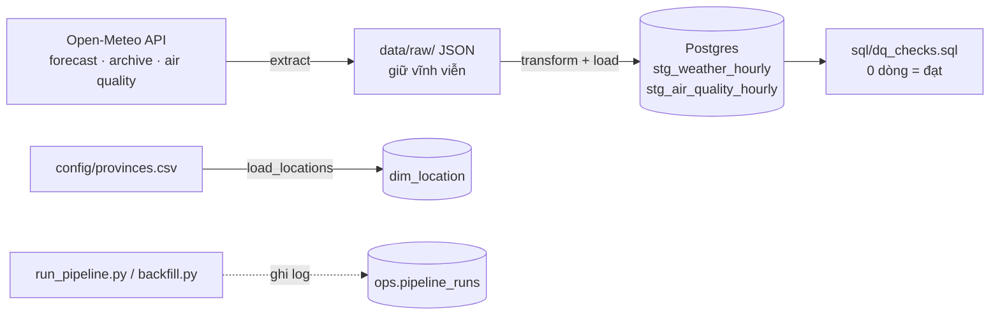

# VietSky

Pipeline dữ liệu thời tiết và chất lượng không khí cho 34 tỉnh thành Việt Nam.

## Kiến trúc



**Luồng dữ liệu:**
1. **Nguồn:** VietSky lấy dữ liệu theo giờ của 34 tỉnh từ Open-Meteo, gồm 2 nguồn là thời tiết và chất lượng không khí. Mỗi lần gọi API có retry kèm backoff khi API lỗi tạm thời.
2. **Raw:** response được lưu nguyên dạng JSON vào `data/raw/` trước khi xử lý. Raw là nguồn sự thật: database hỏng thì dựng lại được từ raw, không cần gọi lại API.
3. **Transform + load:** mỗi giờ thành 1 dòng, giờ địa phương được gắn múi giờ để lưu chuẩn UTC, tên cột API được đổi sang tên cột trong DB. Dữ liệu ghi vào bảng staging bằng upsert theo khoá (tỉnh, giờ), nên chạy lại không sinh trùng và số liệu bị nguồn sửa sẽ được cập nhật.
4. **Chất lượng:** `sql/dq_checks.sql` dò dòng trùng, giá trị thiếu, giá trị vô lý, giờ bị hở và tỉnh bị thiếu (0 dòng = đạt). Unit test (`pytest`) giữ cho logic biến đổi không bị hỏng lại khi sửa code.
5. **Vận hành:** mỗi lần chạy có một `run_id`. Mỗi chặng ghi 1 dòng vào `ops.pipeline_runs` gồm trạng thái, thời gian, `rows_in`/`rows_out` và lỗi, để biết pipeline có chạy không và hỏng ở chặng nào.

## Cách chạy

Yêu cầu: Docker, Python 3.12+.

1. Tạo file `.env` ở thư mục gốc, gồm 3 biến `POSTGRES_DB`, `POSTGRES_USER`, `POSTGRES_PASSWORD`. Không commit file này.
2. Cài thư viện và khởi động database (Postgres chạy ở cổng 5433):
   ```bash
   python -m venv .venv && .venv/bin/pip install -r requirements.txt
   docker compose up -d
   ```
3. Tạo bảng, chỉ làm lần đầu (`01_staging.sql` có `DROP TABLE`, chạy lại sẽ xoá dữ liệu staging):
   ```bash
   psql -h localhost -p 5433 -U <user> -d <db> -f sql/00_ops.sql
   psql -h localhost -p 5433 -U <user> -d <db> -f sql/01_staging.sql
   ```
4. Chạy pipeline hằng ngày (8 ngày gần nhất tính đến `--date`, mặc định là hôm nay):
   ```bash
   PYTHONPATH=src .venv/bin/python pipelines/run_pipeline.py --date 2026-11-23
   ```
5. Nạp lịch sử (chia đoạn theo năm, chạy lại an toàn):
   ```bash
   PYTHONPATH=src .venv/bin/python pipelines/backfill.py --start 2022-08-04
   ```
6. Kiểm tra:
   ```bash
   .venv/bin/python -m pytest
   psql -h localhost -p 5433 -U <user> -d <db> -f sql/dq_checks.sql
   ```

## Data profiling

Ngày kiểm tra: 20/11/2026 · Tọa độ thử: TP.HCM (10.82, 106.63)

### Air Quality API (`pm2_5`)

| Mốc | start_date = end_date | Status | Dữ liệu (số thật / toàn null) | Ghi chú (`reason` nếu lỗi) |
|---|---|--------|-------------------------------|---|
| 1 tháng trước | 2026-10-20 | 200    | số thật                       | |
| 6 tháng trước | 2026-05-20 | 200    | số thật                       | |
| 1 năm trước | 2025-11-20 | 200    | số thật                       | |
| 3 năm trước | 2023-11-20 | 200    | số thật                       | |
| 5 năm trước | 2021-11-20 | 200    | toàn null                     | ⚠️ 200 nhưng không có dữ liệu (lỗi im lặng) |

### Weather API `/v1/forecast` (`temperature_2m`)

| Mốc | start_date = end_date | Status | Dữ liệu (số thật / toàn null) | Ghi chú (`reason` nếu lỗi) |
|---|---|--------|------------------------|---|
| 1 tháng trước | 2026-10-20 | 200    | số thật                | |
| 6 tháng trước | 2026-05-20 | 400    |                        | Parameter 'start_date' is out of allowed range from 2026-08-19 to 2026-12-05 |
| 1 năm trước | 2025-11-20 |    400       |                        | Parameter 'start_date' is out of allowed range from 2026-08-19 to 2026-12-05|
| 3 năm trước | 2023-11-20 |     400      |                        | Parameter 'start_date' is out of allowed range from 2026-08-19 to 2026-12-05|
| 5 năm trước | 2021-11-20 |      400     |                        | Parameter 'start_date' is out of allowed range from 2026-08-19 to 2026-12-05|

### Kết luận

- **Air Quality**: API nhận ngày từ 2013-01-01 (đúng định dạng thì vẫn trả 200), nhưng **số thật chỉ có từ 2022-08-04**; trước đó `pm2_5` toàn `null`.
- **Weather `/v1/forecast`**: chỉ nhận khoảng **~3 tháng trước → ~2 tuần tới** (lúc kiểm tra: 2026-08-19 → 2026-12-05); ngoài khoảng → 400 kèm `reason`. Cửa sổ này **trượt theo ngày**.
- **Ảnh hưởng tới pipeline**:
  - Dữ liệu thời tiết cũ hơn ~3 tháng sẽ **không lấy lại được** từ `/forecast` → phải chạy hằng ngày và **giữ raw vĩnh viễn**; raw là nguồn lịch sử duy nhất.
  - Kiểm tra số dòng là chưa đủ: 200 + đủ 24 dòng vẫn có thể toàn `null` → cần thêm check tỉ lệ `NULL`.
  - Muốn lịch sử thời tiết dài hơn phải dùng API khác (Historical Weather / archive) — nguồn mới, profiling lại.

## Backfill lịch sử (23/11/2026)

Lệnh: `PYTHONPATH=src .venv/bin/python pipelines/backfill.py --start 2022-08-04` (chia đoạn theo năm, upsert, commit sau mỗi tỉnh-năm).

| Nguồn | Khoảng thời gian | Số dòng | Thời gian chạy | Retry |
|---|---|---|---|---|
| weather (archive API) | 2022-08-04 → 2026-11-23 | 1.283.568 | 397s | 0 |
| air_quality | 2022-08-04 → 2026-11-23 | 1.283.568 | 475s | 0 |

- Mỗi năm đủ 34 × 24 × số ngày (2024 năm nhuận: 298.656). Không có khe hở giờ (DQ4 = 0).
- 238 dòng `pm2_5` NULL = 7 giờ đầu ngày 04/08/2022 × 34 tỉnh: dữ liệu thật bắt đầu từ 07:00 giờ VN.
- Archive API không trễ (có dữ liệu đến hôm nay); vài ngày gần nhất có thể bị nguồn sửa lại, upsert sẽ ghi đè.
