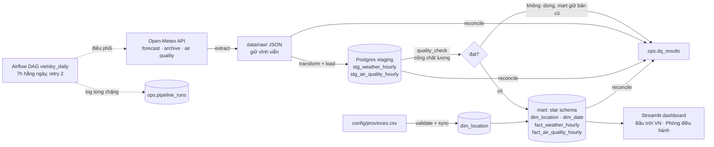

# VietSky

Pipeline dữ liệu thời tiết và chất lượng không khí theo giờ cho 34 tỉnh thành Việt Nam (sau sáp nhập 01/7/2025), từ 08/2022 đến nay: **~2,58 triệu bản ghi**.
Dữ liệu đi qua raw → staging → cổng chất lượng → star schema, được điều phối bằng Airflow, kiểm tra bằng 9 check chất lượng (gồm đối soát raw = staging = mart theo ngày), và phục vụ qua dashboard phân tích + vận hành. Dự án có 6 kịch bản sự cố được diễn tập, kèm postmortem và runbook.

**Công nghệ:** Python 3.13 · PostgreSQL 16 · Apache Airflow 3 · Docker Compose · pandas · DuckDB · Parquet · Streamlit · Plotly · pytest

## Kiến trúc



**Luồng dữ liệu:**
1. **Nguồn:** VietSky lấy dữ liệu theo giờ của 34 tỉnh từ Open-Meteo, gồm 2 nguồn là thời tiết và chất lượng không khí. Mỗi lần gọi API có retry kèm backoff khi API lỗi tạm thời.
2. **Raw:** response được lưu nguyên dạng JSON vào `data/raw/` trước khi xử lý. Raw là nguồn sự thật: database hỏng thì dựng lại được từ raw, không cần gọi lại API.
3. **Transform + load:** mỗi giờ thành 1 dòng, giờ địa phương được gắn múi giờ để lưu chuẩn UTC, tên cột API được đổi sang tên cột trong DB. Dữ liệu ghi vào bảng staging bằng upsert theo khoá (tỉnh, giờ), nên chạy lại không sinh trùng và số liệu bị nguồn sửa sẽ được cập nhật.
4. **Mart:** sau khi qua cổng chất lượng, chặng `build_mart` dựng star schema trong schema `mart`. Grain của fact là 1 tỉnh × 1 giờ; giờ, ngày, tháng, mùa được tính sẵn theo giờ VN. Dim được upsert để khoá ổn định, fact được dựng lại toàn bộ. Số dòng staging phải bằng số dòng mart, lệch thì rollback và giữ dữ liệu cũ.
5. **Chất lượng:** chặng `quality_check` (`src/vietsky/quality.py`) chạy **trước** mart như một cổng (Write-Audit-Publish): kiểm tra phần vừa nạp (8 ngày) và ghi từng kết quả vào `ops.dq_results`; lỗi `CRITICAL` thì không dựng mart. Chặng `reconcile` chạy sau mart. Quy tắc trên staging: không NULL ở khoá, không trùng khoá, đủ 34 tỉnh, độ mới (`loaded_at` trong 24 giờ), PM2.5 trong 0–1000, cột đo chính không NULL. Kiểm tra schema JSON raw (đủ `time` và các cột đo). Đối soát raw = staging = mart theo từng ngày giờ VN, để biết dữ liệu rơi ở tầng nào. Lỗi mức `CRITICAL` làm chặng FAILED; `WARNING` chỉ ghi lại. Unit test (`pytest`) giữ cho logic biến đổi không bị hỏng lại khi sửa code.
6. **Điều phối:** Airflow DAG `vietsky_daily` chạy 7h sáng giờ VN; 2 nguồn chạy song song, mỗi task retry 2 lần (trừ các chặng kiểm tra). Retry an toàn vì mọi chặng idempotent (upsert, full refresh mart, log ghi đè theo `run_id`).
7. **Phục vụ:** dashboard Streamlit 2 trang: phân tích PM2.5 (bản đồ, xu hướng, heatmap giờ × tháng, tương quan mưa/gió) và vận hành (độ mới, các lần chạy, số dòng qua từng chặng, tỷ lệ đạt kiểm tra).
8. **Vận hành:** mỗi lần chạy có một `run_id`. Mỗi chặng ghi 1 dòng vào `ops.pipeline_runs` gồm trạng thái, thời gian, `rows_in`/`rows_out` và lỗi, để biết pipeline có chạy không và hỏng ở chặng nào.

## Ảnh chụp

**Airflow: DAG `vietsky_daily` chạy thành công**


**Dashboard: Bầu trời Việt Nam**


**Dashboard: Phòng điều hành**


## Cách chạy

Yêu cầu: Docker, Python 3.12+.

1. Tạo file `.env` ở thư mục gốc, gồm 3 biến `POSTGRES_DB`, `POSTGRES_USER`, `POSTGRES_PASSWORD`. Không commit file này.
2. Cài thư viện và khởi động database (Postgres chạy ở cổng 5433):
   ```bash
   python -m venv .venv && .venv/bin/pip install -r requirements.txt
   docker compose up -d
   ```
3. Tạo bảng, chỉ làm lần đầu (`01_staging.sql` có `DROP TABLE`, chạy lại sẽ xoá dữ liệu staging):
   ```bash
   psql -h localhost -p 5433 -U <user> -d <db> -f sql/00_ops.sql
   psql -h localhost -p 5433 -U <user> -d <db> -f sql/01_staging.sql
   psql -h localhost -p 5433 -U <user> -d <db> -f sql/02_mart.sql
   ```
4. Chạy pipeline hằng ngày (extract → load → quality_check → build_mart → reconcile; 8 ngày gần nhất tính đến `--date`, mặc định là hôm nay):
   ```bash
   PYTHONPATH=src .venv/bin/python pipelines/run_pipeline.py --date 2026-11-23
   ```
   Hoặc điều phối bằng Airflow (giao diện ở `http://localhost:8080`, DAG `vietsky_daily`). Lần đầu tạo database `airflow` trong Postgres (`CREATE DATABASE airflow;`):
   ```bash
   docker compose --profile airflow up -d
   ```
   Dashboard:
   ```bash
   PYTHONPATH=src .venv/bin/streamlit run dashboard/app.py
   ```
5. Nạp lịch sử (chia đoạn theo năm, chạy lại an toàn):
   ```bash
   PYTHONPATH=src .venv/bin/python pipelines/backfill.py --start 2022-08-04
   ```
6. Kiểm tra:
   ```bash
   .venv/bin/python -m pytest
   ```
   Xem kết quả kiểm tra chất lượng của lần chạy gần nhất:
   ```sql
   SELECT source, check_name, severity, status, failed_rows
   FROM ops.dq_results
   WHERE run_id = (SELECT run_id FROM ops.dq_results ORDER BY checked_at DESC LIMIT 1)
   ORDER BY status, source, check_name;
   ```

## Data profiling

Ngày kiểm tra: 20/11/2026 · Tọa độ thử: TP.HCM (10.82, 106.63)

### Air Quality API (`pm2_5`)

| Mốc | start_date = end_date | Status | Dữ liệu (số thật / toàn null) | Ghi chú (`reason` nếu lỗi) |
|---|---|--------|-------------------------------|---|
| 1 tháng trước | 2026-10-20 | 200    | số thật                       | |
| 6 tháng trước | 2026-05-20 | 200    | số thật                       | |
| 1 năm trước | 2025-11-20 | 200    | số thật                       | |
| 3 năm trước | 2023-11-20 | 200    | số thật                       | |
| 5 năm trước | 2021-11-20 | 200    | toàn null                     | ⚠️ 200 nhưng không có dữ liệu (lỗi im lặng) |

### Weather API `/v1/forecast` (`temperature_2m`)

| Mốc | start_date = end_date | Status | Dữ liệu (số thật / toàn null) | Ghi chú (`reason` nếu lỗi) |
|---|---|--------|------------------------|---|
| 1 tháng trước | 2026-10-20 | 200    | số thật                | |
| 6 tháng trước | 2026-05-20 | 400    |                        | Parameter 'start_date' is out of allowed range from 2026-08-19 to 2026-12-05 |
| 1 năm trước | 2025-11-20 |    400       |                        | Parameter 'start_date' is out of allowed range from 2026-08-19 to 2026-12-05|
| 3 năm trước | 2023-11-20 |     400      |                        | Parameter 'start_date' is out of allowed range from 2026-08-19 to 2026-12-05|
| 5 năm trước | 2021-11-20 |      400     |                        | Parameter 'start_date' is out of allowed range from 2026-08-19 to 2026-12-05|

### Kết luận

- **Air Quality**: API nhận ngày từ 2013-01-01 (đúng định dạng thì vẫn trả 200), nhưng **số thật chỉ có từ 2022-08-04**; trước đó `pm2_5` toàn `null`.
- **Weather `/v1/forecast`**: chỉ nhận khoảng **~3 tháng trước → ~2 tuần tới** (lúc kiểm tra: 2026-08-19 → 2026-12-05); ngoài khoảng → 400 kèm `reason`. Cửa sổ này **trượt theo ngày**.
- **Ảnh hưởng tới pipeline**:
  - Dữ liệu thời tiết cũ hơn ~3 tháng sẽ **không lấy lại được** từ `/forecast` → phải chạy hằng ngày và **giữ raw vĩnh viễn**; raw là nguồn lịch sử duy nhất.
  - Kiểm tra số dòng là chưa đủ: 200 + đủ 24 dòng vẫn có thể toàn `null` → cần thêm check tỉ lệ `NULL`.
  - Muốn lịch sử thời tiết dài hơn phải dùng API khác (Historical Weather / archive) — nguồn mới, profiling lại.

## Backfill lịch sử (23/11/2026)

Lệnh: `PYTHONPATH=src .venv/bin/python pipelines/backfill.py --start 2022-08-04` (chia đoạn theo năm, upsert, commit sau mỗi tỉnh-năm).

| Nguồn | Khoảng thời gian | Số dòng | Thời gian chạy | Retry |
|---|---|---|---|---|
| weather (archive API) | 2022-08-04 → 2026-11-23 | 1.283.568 | 397s | 0 |
| air_quality | 2022-08-04 → 2026-11-23 | 1.283.568 | 475s | 0 |

- Mỗi năm đủ 34 × 24 × số ngày (2024 năm nhuận: 298.656). Không có khe hở giờ (DQ4 = 0).
- 238 dòng `pm2_5` NULL = 7 giờ đầu ngày 04/08/2022 × 34 tỉnh: dữ liệu thật bắt đầu từ 07:00 giờ VN.
- Archive API không trễ (có dữ liệu đến hôm nay); vài ngày gần nhất có thể bị nguồn sửa lại, upsert sẽ ghi đè.

## Benchmark CSV vs Parquet (25/11/2026)

Dữ liệu: `fact_air_quality_hourly` JOIN dim, 1.284.384 dòng × 11 cột, xuất bằng `pipelines/export_lake.py` ra `data/lake/`. Đo bằng `pipelines/benchmark.py` (pandas 3.1, DuckDB 2.0, MacBook SSD). Query mẫu: PM2.5 trung bình của Hà Nội tháng 1/2025. Cả 3 định dạng cùng ra **71,4**.

| Định dạng | Dung lượng | Đọc toàn bộ (pandas) | Query 1 tỉnh × 1 tháng (DuckDB) |
|---|---|---|---|
| CSV | 91,6 MB | 0,07–0,09 s | 0,145 s |
| Parquet 1 file | 10,2 MB | 0,09–0,13 s | 0,004 s |
| Parquet phân vùng `year=/month=` (52 file) | 18,8 MB | — | 0,013 s |

**Kết luận:** Parquet nhỏ hơn CSV **9 lần**; query phân tích nhanh hơn **~35 lần** (1 file) và **~11 lần** (phân vùng).

- Đọc toàn bộ cả 11 cột thì Parquet không nhanh hơn: lợi thế lưu theo cột chỉ có khi query chọn ít cột và có lọc.
- Partition pruning có hoạt động (`Scanning Files: 1/52`), nhưng với 92 MB thì chi phí liệt kê 52 file lớn hơn lợi ích bỏ qua file. Thống kê min/max trong footer của 1 file Parquet đã đủ để bỏ qua dữ liệu không cần đọc (predicate pushdown).
- Bản phân vùng to gần gấp đôi vì mỗi file nhỏ mang footer và từ điển nén riêng (small files problem). Phân vùng chỉ đáng giá khi dữ liệu lên hàng trăm GB trên object storage.
- CSV làm mất kiểu dữ liệu: DuckDB đọc `location_id` thành số nguyên (`'01'` → `1`), `us_aqi` thành số thực. Parquet lưu schema trong file nên giữ nguyên kiểu.

## Chất lượng dữ liệu và diễn tập sự cố

Mỗi lần chạy ghi kết quả từng check vào `ops.dq_results` (grain: 1 check × 1 nguồn × 1 lần chạy).

| Check | Tầng | Mức | Bắt lỗi gì |
|---|---|---|---|
| `raw_schema` (cũng chạy đầu chặng load) | raw | CRITICAL | Nguồn đổi tên/xoá trường (schema drift) |
| `not_null_key`, `unique_key` | staging | CRITICAL | Mất khoá, trùng dòng |
| `all_provinces` | staging | CRITICAL | Thiếu tỉnh |
| `freshness_24h` | staging | CRITICAL | Không nạp được dữ liệu mới trong 24h (theo `loaded_at`) |
| `pm25_not_null`, `temperature_not_null` | staging | CRITICAL | Nguồn trả toàn NULL cho 1 tỉnh |
| `pm25_range` | staging | WARNING | Giá trị vô lý (< 0 hoặc > 1000 µg/m³) |
| `reconcile_daily` | raw = staging = mart | CRITICAL | Dữ liệu rơi ở tầng nào, ngày nào |

`src/vietsky/chaos.py` gây lỗi có chủ đích (bật bằng `VIETSKY_CHAOS=<lỗi>`). Báo cáo đầy đủ ở [`docs/incidents/`](docs/incidents/), quy trình xử lý ở [`docs/runbook.md`](docs/runbook.md).

| # | Sự cố | Phát hiện bằng | Thời gian phát hiện | Phát hiện mới / đã sửa |
|---|---|---|---|---|
| 01 | API trả HTTP 500 | retry 4 lần → extract FAILED | 16 s | 2 lớp retry: code (giây) + Airflow (phút) |
| 02 | Đổi tên `pm2_5` → `pm25` | load FAILED `'pm2_5'` | ~75 s | `raw_schema` đứng sau load nên không kịp chạy → thêm kiểm tra schema ở đầu load |
| 03 | 1 tỉnh trả toàn NULL | lần 1: **không phát hiện**, 192 giờ NULL vào mart | ~1 s (sau khi sửa) | Thêm `*_not_null`; cổng chất lượng chặn `build_mart` |
| 04 | Đảo lat/lon 3 tỉnh | kiểm tra toạ độ khi khởi động | < 1 s | Hàm kiểm tra có từ trước nhưng pipeline không gọi → gắn vào `sync_locations` |
| 05 | Giờ VN gắn nhãn UTC | không check nào bắt (tabletop) | — | Chỉ heatmap thấy; đề xuất anomaly check theo giờ |
| 06 | Chạy 2 lần, tắt upsert | PK staging → `unique_key` → reconcile | ngay | Phòng thủ nhiều lớp |

## Bài học rút ra
- **Raw là nguồn sự thật.** Giữ nguyên JSON của API nên mọi lỗi transform/load đều sửa được bằng cách nạp lại, không phải gọi lại API (`/forecast` chỉ giữ ~3 tháng).
- **Idempotency là điều kiện để retry và backfill an toàn:** upsert theo khoá tự nhiên, full refresh cho fact, xoá thư mục trước khi ghi Parquet phân vùng, log ghi đè theo `run_id`.
- **"Đủ dòng" không có nghĩa là "đủ dữ liệu".** Đối soát số dòng không thấy được 192 giờ NULL; cần kiểm tra cả cấp giá trị.
- **Vị trí của check quan trọng như nội dung check.** Check đặt sau bước nó cần bảo vệ thì vô dụng (sự cố 02). Kiểm tra trước khi công bố (Write-Audit-Publish), không phải sau.
- **Kiểm tra cả bộ kiểm tra:** so sánh `'FAIL'` với `'fail'` từng làm pipeline không bao giờ dừng. Gây lỗi cố ý là cách duy nhất để biết check có thật sự hoạt động.
- **Freshness đo bằng mốc mình kiểm soát** (`loaded_at`), không phải `ts_utc` của dữ liệu dự báo (có giờ tương lai, khiến check luôn đạt).
- **Tối ưu có chi phí:** Parquet phân vùng chậm hơn 1 file ở quy mô 92 MB (small files problem). Đo trước khi tin.

## Nguồn dữ liệu
Dữ liệu thời tiết và chất lượng không khí từ [Open-Meteo](https://open-meteo.com/) (giấy phép CC BY 4.0); chất lượng không khí dựa trên mô hình CAMS (Copernicus). Toạ độ 34 tỉnh: `config/provinces.csv`.
